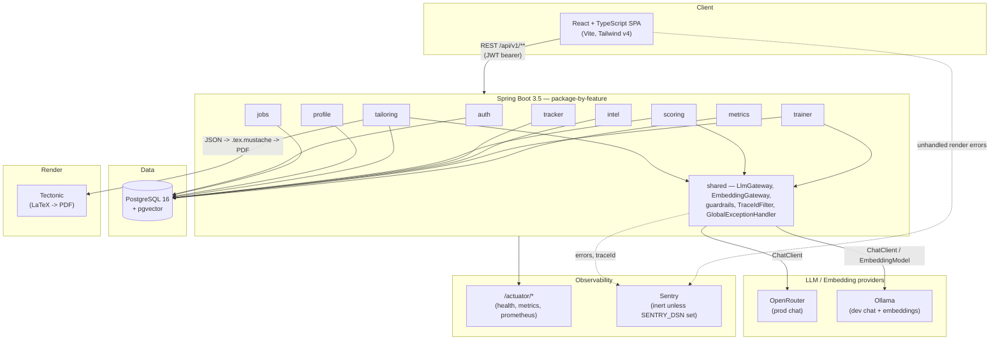

# Career Copilot

A multi-user career copilot: ingest job postings, build a structured experience corpus, tailor
resumes against a specific job with a grounded RAG pipeline, score the result against real-ATS
keyword heuristics, track applications end to end, pool anonymized company interview intel, and
practice with a spaced-repetition mock-interview trainer.

**As an AI/ML application:** a RAG pipeline — a per-user experience corpus embedded in pgvector,
retrieval-augmented resume tailoring, LLM-driven JSON extraction (never free-text or LaTeX),
deterministic ATS scoring, and anonymized interview-intel pooling.

**As an SDE/full-stack project:** a Spring Boot 3.5 REST API + React/TypeScript SPA, JWT auth,
Flyway-managed PostgreSQL, Docker + DigitalOcean App Platform deploy, GitHub Actions CI.

## Architecture



See `planning/06-architecture-diagram.md` for the annotated version and `planning/` for the full
design history (requirements → architecture → system design → database → API).

## Product surface (Phases 0–7)

| Phase | What it delivers |
|---|---|
| 0 — Foundation | Spring Boot + Postgres/pgvector skeleton, JWT auth, React shell, CI, first deploy |
| 1 — Job ingestion | Pluggable job-source adapters (RemoteOK, Greenhouse, Lever, Ashby, Adzuna, Jooble, manual paste), public browse/search |
| 2 / 2E — Profile & corpus | Owner-scoped profile, typed experience corpus (work/internship/project/POR/publication), education, skills, highlights; async embedding via `EmbeddingGateway` |
| 3 — Resume tailoring | RAG tailoring pipeline: embed JD → retrieve top-k corpus entries → guardrailed LLM JSON → deterministic LaTeX render → PDF |
| 4 — ATS gap scorer | LLM keyword extraction + deterministic composite score (required/preferred coverage + keyword density), embedding-based near-misses, template fixes |
| 5 — Application tracker | Kanban-style application + interview-log tracking with a validated status machine |
| 6 — Company intel | Anonymized, aggregation-gated (N≥3), publicly browsable interview intel pooled across users |
| 7 — Mock-interview trainer | LLM-generated practice questions grounded in your own logs + public intel + curated role patterns, LLM-graded answers, a pure SM-2 spaced-repetition scheduler |
| 8 — Hardening & metrics | This phase: the headline ATS-improvement metric, latency/token telemetry, adversarial guardrail coverage, OpenAPI docs, and frontend polish — see below |

## The headline metric

Career Copilot's headline number is **before/after ATS coverage improvement** — how much a
tailored resume's keyword coverage beats a generic, untailored one for the same job description.
It's computed two ways, both exposed at `GET /api/v1/metrics/ats-improvement` (authenticated, no
PII):

- **Labeled set** — a 20-JD hand-labeled eval set (`AtsEvalHarnessTest`, `src/main/resources/eval/ats-labeled-set.json`), scored deterministically (no LLM) through the production `CoverageScorer`.
- **Live users** — an aggregate over real `scoring_results` rows (min→max score per user+job), never exposing which user or job.

Latency (p50/p99), tokens per tailoring run, and retrieval precision@k are also measured — see
`GET /api/v1/metrics/tokens` and `/actuator/prometheus`.

## Tech stack

| Layer | Technology |
|---|---|
| Runtime | Java 21 |
| Framework | Spring Boot 3.5, Spring AI 1.1 |
| Security | Spring Security (JWT) |
| Database | PostgreSQL 16 + pgvector, Flyway migrations |
| LLM (prod) | OpenRouter (OpenAI-compatible) |
| LLM (dev) | Ollama |
| Resume render | Tectonic (LaTeX) |
| Frontend | React 19 + TypeScript, Vite, Tailwind v4 |
| Observability | Micrometer/Actuator + Prometheus, Sentry (inert by default), structured JSON logs with `traceId` |
| API docs | springdoc-openapi, served at `/api/v1/docs` |
| CI | GitHub Actions |
| Hosting | DigitalOcean App Platform + Managed Postgres |

## Quickstart

```bash
# Backend — needs a local Postgres with pgvector on 5432, and JWT_SECRET set
./mvnw spring-boot:run

# Frontend
cd frontend
cp .env.example .env   # set VITE_API_BASE_URL if the backend isn't on localhost:8080
npm install
npm run dev
```

Then open `http://localhost:5173`. API docs: `http://localhost:8080/api/v1/docs/swagger-ui`.

Full backend test suite (needs Docker for Testcontainers):

```bash
./mvnw test
```

## Environment variables

| Variable | Default | Purpose |
|---|---|---|
| `SPRING_DATASOURCE_URL` / `_USERNAME` / `_PASSWORD` | — | Postgres connection |
| `JWT_SECRET` | — | JWT signing secret (required) |
| `JWT_EXPIRY_SECONDS` | `86400` | Token lifetime |
| `CORS_ALLOWED_ORIGIN` | `http://localhost:5173` | Single allowed SPA origin |
| `OPENROUTER_API_KEY` | — | Prod chat LLM |
| `LLM_TAILORING_MODEL` / `LLM_EXTRACTION_MODEL` | free-tier OpenRouter models | Model per tier (see `llm.tiers` in `application.yml`) |
| `OLLAMA_BASE_URL` | `http://localhost:11434` | Dev chat + embeddings |
| `EMBEDDING_MODEL` / `EMBEDDING_DIMENSION` | `nomic-embed-text` / `768` | Embedding model + `vector(N)` column width |
| `RETRIEVAL_TOP_K` | `6` | Corpus entries retrieved per tailoring run |
| `TECTONIC_TIMEOUT_SECONDS` | `30` | Resume render timeout |
| `SCORING_NEARMISS_THRESHOLD` | `0.75` | Cosine threshold for ATS near-misses |
| `INTEL_MIN_AGGREGATION` | `3` | Min anonymized entries before a company's intel is published |
| `TRAINER_DAILY_NEW_LIMIT` | `20` | New (never-answered) practice questions per UTC day |
| `SENTRY_DSN` / `VITE_SENTRY_DSN` | *(empty → inert)* | Backend / frontend Sentry DSN |
| `SENTRY_ENVIRONMENT` | `local` | Sentry environment tag |
| `SENTRY_TRACES_SAMPLE_RATE` | `0.1` | Backend trace sampling |
| `LOG_FORMAT` | *(empty → plain)* | Set `ecs` for structured JSON logs in prod |

## More

- `planning/` — the original design docs (requirements, architecture, system design, database, API, architecture diagram).
- `progress_report.md` — the running, phase-by-phase build log.
- `docs/demo-script.md` — an end-to-end walkthrough for a live demo.
- `docs/rate-limiting.md` — recommended rate limits (config doc; no in-app limiter yet).
- `CLAUDE.md` — project rules and conventions this codebase was built under.
